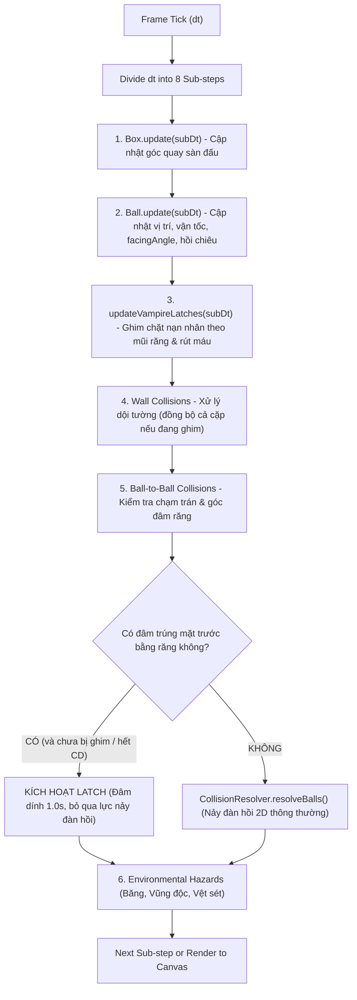

# RE-BOUND: Developer & AI Agent Collaboration Guide

> **Mục tiêu của tài liệu này:** Cung cấp bản đồ kiến trúc toàn diện, quy chuẩn code và hướng dẫn thực thi nhanh (*Quick-action Recipes*) để bất kỳ AI Agent hoặc lập trình viên mới nào có thể đọc hiểu toàn bộ dự án trong **dưới 2 phút**, can thiệp chính xác vào đúng file mà **không cần đọc hoặc quét toàn bộ codebase**.

---

## 1. Tổng quan Dự án & Tech Stack

- **Game Name:** Re-Bound (Đấu trường bóng nảy chiến thuật)
- **Tech Stack:**
  - Ngôn ngữ: **TypeScript** (Strict mode)
  - Bundler & Dev Server: **Vite 8**
  - Đồ họa: **HTML5 Canvas 2D** (Không dùng engine nặng như Phaser hay Pixi)
  - Âm thanh: **Web Audio API** (Tổng hợp âm thanh procedural trực tiếp bằng mã nguồn, không phụ thuộc file mp3/wav ngoài)
  - Giao diện: Thuần HTML5 / CSS3 Glassmorphism hiện đại, responsive
- **Chế độ chơi:**
  - **Sandbox Duel (1v1):** Tùy chọn 2 tướng, xoay chỉnh góc nhắm tự do, nhấn Ready -> đếm ngược 3s -> phóng đọ sức.
  - **Battle Royale (4 bóng ngẫu nhiên):** Chọn 4 tướng ngẫu nhiên từ 9 tướng, tự do nảy và chiến đấu sinh tồn trong sàn đấu xoay.

---

## 2. Bản đồ File & Phân chia Trách nhiệm (File Ownership Map)

| Đường dẫn file | Trách nhiệm chính | Khi nào Agent cần sửa file này? |
| :--- | :--- | :--- |
| [`src/types.ts`](file:///d:/Work_Dev/re-bound/src/types.ts) | Định nghĩa toàn bộ TypeScript Interfaces, Enums, Type Union (`BallTypeId`, `StatusEffect`, `SkillConfig`, `GameMode`, v.v.) | Khi thêm Tướng mới, thêm Hiệu ứng khống chế mới, hoặc mở rộng thuộc tính Ball/Engine. |
| [`src/entities/BallTypes.ts`](file:///d:/Work_Dev/re-bound/src/entities/BallTypes.ts) | Cấu hình chỉ số (`baseHp`, `baseAttack`, `baseRadius`, `skin`, `skill`) và metadata (`HERO_EXTRA_META`) bằng tiếng Việt cho cả 9 tướng | Khi cân bằng chỉ số (Balance Patch), đổi màu sắc skin, đổi tên/mô tả skill, cập nhật mẹo chiến thuật. |
| [`src/entities/Ball.ts`](file:///d:/Work_Dev/re-bound/src/entities/Ball.ts) | Lớp đối tượng quả bóng: Quản lý HP, Overheal, Status Effects, `facingAngle`, vẽ Canvas chuẩn (body, health bar, aim guide), ủy nhiệm chiêu thức qua `SkillStrategy` | Khi thay đổi logic nhận sát thương/hồi máu cốt lõi hoặc xử lý buff/debuff tick chung. |
| [`src/skills/`](file:///d:/Work_Dev/re-bound/src/skills/) | Hệ thống Skill Strategy tách biệt cho từng tướng (`BlazeSkill`, `VoidSkill`, `AxeSkill`, v.v.) và `SkillFactory` | Khi thay đổi cơ chế chiêu thức, hiệu ứng đồ họa riêng, hoặc thêm tướng mới. |
| [`src/hazards/`](file:///d:/Work_Dev/re-bound/src/hazards/) | Quản lý chướng ngại vật & bẫy đấu trường (`HazardManager`): Vực băng, bãi axit, vệt sét, mưa thiên thạch | Khi thêm loại bẫy sàn mới, đổi tần suất/sát thương DoT của bẫy, hoặc chỉnh đồ họa bẫy. |
| [`src/ui/PlayerSlotUI.ts`](file:///d:/Work_Dev/re-bound/src/ui/PlayerSlotUI.ts) | Component quản lý giao diện Player 1 và Player 2 (Setup table, preview, slider góc bắn, HUD chiến đấu thời gian thực với dirty-checking) | Khi sửa layout hoặc tương tác của từng bên người chơi. |
| [`src/ui/UIManager.ts`](file:///d:/Work_Dev/re-bound/src/ui/UIManager.ts) | Quản lý DOM UI cấp cao: Topbar, nút đổi chế độ, modal thắng thua, roster chế độ Battle | Khi thêm nút điều khiển toàn cục hoặc chỉnh modal kết quả trận đấu. |
| [`src/vfx/ParticleSystem.ts`](file:///d:/Work_Dev/re-bound/src/vfx/ParticleSystem.ts) | Hệ thống hiệu ứng hạt: Sparks, vệt chuyển động, vòng sóng xung kích (Shockwave), chữ bay (Floating Text), rung màn hình | Khi cần thêm loại hạt mới, đổi màu sắc chữ số sát thương/hồi máu. |
| [`src/audio/SoundFX.ts`](file:///d:/Work_Dev/re-bound/src/audio/SoundFX.ts) | Bộ phát âm thanh Web Audio: Tạo sóng âm (sine, triangle, square, saw) và noise | Khi thêm âm thanh mới cho kỹ năng, va chạm, hoặc trạng thái game. |
| [`src/style.css`](file:///d:/Work_Dev/re-bound/src/style.css) | Toàn bộ CSS phong cách Dark Sci-Fi Cyberpunk / Glassmorphism | Khi đổi giao diện, căn chỉnh layout, hoặc tạo keyframe animation. |
| [`index.html`](file:///d:/Work_Dev/re-bound/index.html) | Khung cấu trúc HTML5, các modal và hướng dẫn cơ chế | Khi thêm thẻ DOM mới hoặc cập nhật nội dung bảng hướng dẫn chơi. |

---

## 3. Quy trình Vòng Lặp Mô Phỏng (Simulation Sub-Stepping Pipeline)

Trong mỗi khung hình (`dt` từ `requestAnimationFrame`), `GameEngine` chia nhỏ thời gian thành **8 sub-steps** (`subDt = dt / 8`). Việc này đảm bảo tính ổn định vật lý cao tuyệt đối, ngăn hiện tượng lọt xuyên tường (tunneling):



---

## 4. Các Nguyên Tắc Bất Di Bất Dịch (Critical Invariants & Gotchas)

> [!CAUTION]
> Bất kỳ Agent nào chỉnh sửa code cần tuyệt đối tuân thủ 5 nguyên tắc sau để không làm hỏng tính nhất quán của hệ thống:

1. **`facingAngle` và Thứ Tự Tính Toán Góc Đâm:**
   - Hướng mặt của bóng (`ball.facingAngle`) được đồng bộ liên tục từ `aimAngle` khi đang nhắm và `Math.atan2(vy, vx)` khi đang di chuyển.
   - **BẮT BUỘC:** Phải kiểm tra góc tiếp xúc và góc đâm (`angleB1ToB2` so với `facingAngle`) **TRƯỚC** khi gọi `CollisionResolver.resolveBalls()`.
   - *Lý do:* `resolveBalls()` sẽ đảo ngược vận tốc ngay lập tức do xung lực nảy đàn hồi. Nếu kiểm tra sau, góc vận tốc đã quay ngược $180^\circ$ và điều kiện đâm trực diện sẽ luôn bị tính sai thành FALSE!

2. **Cơ Chế Đâm Dính (Latch) vs Va Chạm Đàn Hồi:**
   - Khi Ma Cà Rồng đâm trúng bằng răng mặt trước ($\pm 72^\circ$), **TUYỆT ĐỐI KHÔNG** để `CollisionResolver.resolveBalls()` chạy lên cặp bóng đó.
   - Khi hai bóng đang dính nhau (`latchedTargetId !== null` hoặc `latchedByVampireId !== null`), mọi tương tác nảy đàn hồi giữa chúng phải được vô hiệu hóa để không kéo giật vị trí.

3. **Cơ Chế Đóng Băng (Freeze Damage Rule):**
   - Bóng đang bị đóng băng (`FROZEN` hoặc `FROZEN_SOLID`) khi va chạm sẽ gây **0 sát thương** (`dmg = 0`). Tuy nhiên các bóng khác đâm vào bóng bị đóng băng vẫn gây sát thương bình thường.

4. **Overheal (Huyết Thuẫn):**
   - Quả bóng chỉ được phép hồi máu vượt quá `maxHp` (lên tới $1.5 \times \text{maxHp}$) khi đang kích hoạt Nộ (`isSkillActive = true`).
   - Máu dư Overheal được hiển thị đặc biệt bằng màu đỏ thẫm/neon `#f43f5e` trên cả thanh máu trên bóng lẫn HUD.

5. **Quy Tắc Âm Thanh Web Audio:**
   - Không được dùng file `.mp3` ngoài. Mọi âm thanh được tạo thông qua `SoundFX.ts`.
   - Luôn kiểm tra `if (!this.ctx) return;` và hàm `resume()` khi có tương tác người dùng.

---

## 5. Hướng Dẫn Nhanh Cho Các Tác Vụ Thường Gặp (Agent Recipes)

### Recipe 1: Thêm một Tướng Bóng Mới (Add a New Hero Ball)
Chỉ cần thực hiện đúng 4 bước cực kỳ nhanh chóng:
1. **[`src/types.ts`](file:///d:/Work_Dev/re-bound/src/types.ts):** Thêm tên định danh vào `BallTypeId` (ví dụ `'SHADOW'`).
2. **[`src/entities/BallTypes.ts`](file:///d:/Work_Dev/re-bound/src/entities/BallTypes.ts):** 
   - Thêm cấu hình trong `BALL_CONFIGS.SHADOW`:
     ```ts
     SHADOW: {
       baseRadius: 19,
       baseHp: 115,
       baseAttack: 11,
       skin: { name: 'Shadow Phantom', vietnameseName: 'Hắc Ảnh', icon: '👤', primaryColor: '#...', ... },
       skill: { name: 'Shadow Clone', vietnameseName: 'Phân Thân', cooldown: 7.0, duration: 3.0, ... }
     }
     ```
   - Thêm metadata chiến thuật vào `HERO_EXTRA_META.SHADOW` (role, roleColor, tactics).
3. **[`src/skills/`](file:///d:/Work_Dev/re-bound/src/skills/):**
   - Tạo class kỹ năng `ShadowSkill.ts` triển khai `SkillStrategy` (`activate`, `onActiveTick`, `onEnd`, `renderOverlay`...).
   - Đăng ký `SHADOW: return new ShadowSkill()` vào `SkillFactory.ts`.
   *(Lưu ý: Hoàn toàn không cần sửa hay nhồi logic vào `Ball.ts`!)*
4. **[`src/audio/SoundFX.ts`](file:///d:/Work_Dev/re-bound/src/audio/SoundFX.ts):** Viết thêm một hàm phát âm thanh đặc trưng (ví dụ `playShadowDash()`).

### Recipe 2: Thêm một Hiệu Ứng Trạng Thái Mới (Add a New Status Effect)
1. Thêm tên hiệu ứng vào `StatusEffectType` trong [`src/types.ts`](file:///d:/Work_Dev/re-bound/src/types.ts) (ví dụ `'STUNNED'`).
2. Trong [`src/entities/Ball.ts`](file:///d:/Work_Dev/re-bound/src/entities/Ball.ts):
   - Xử lý tác động trong vòng lặp `for (const effect of this.statusEffects)` ở hàm `Ball.update()`.
   - Vẽ hiệu ứng hình ảnh (icon, hào quang) trong phần `// 5. Status Effect Visuals` ở hàm `Ball.render()`.
3. Trong [`src/core/GameEngine.ts`](file:///d:/Work_Dev/re-bound/src/core/GameEngine.ts): Xử lý tương tác nếu hiệu ứng ảnh hưởng đến va chạm hoặc nhận sát thương.

### Recipe 3: Thêm Chướng Ngại Vật Mới Lên Sàn Đấu
1. Trong [`src/types.ts`](file:///d:/Work_Dev/re-bound/src/types.ts): Khai báo interface cho chướng ngại vật (vị trí `x, y`, kích thước, thời gian tồn tại `duration`).
2. Trong [`src/hazards/HazardManager.ts`](file:///d:/Work_Dev/re-bound/src/hazards/HazardManager.ts):
   - Thêm mảng chứa (ví dụ `public shadowRifts: ShadowRift[] = [];`).
   - Thêm hàm tạo `createShadowRift(...)`.
   - Cập nhật thời gian & va chạm với các bóng trong `update()`.
   - Vẽ lên màn hình trong `render()`.
   - Reset mảng trong `clear()`.
   *(Lưu ý: `GameEngine` tự động gọi `hazardManager.update()`, `render()` và `clear()`, không cần nhồi code vào `GameEngine.ts`!)*

---

## 6. Quy Trình Kiểm Thử & Xác Nhận (Verification Runbook)

Trước khi bàn giao bất kỳ tính năng hoặc sửa lỗi nào:
1. **Kiểm tra biên dịch Type-check & Build:**
   ```bash
   npm run build
   ```
   *Yêu cầu bắt buộc:* Lệnh phải thoát với mã code 0 (`tsc && vite build` thành công, không có bất kỳ cảnh báo TypeScript nào).
2. **Kiểm tra máy chủ phát triển (Dev Server):**
   - Đảm bảo Vite đang phục vụ tại `http://localhost:5173/`.
   - Kiểm tra Console trình duyệt không có runtime exceptions.
