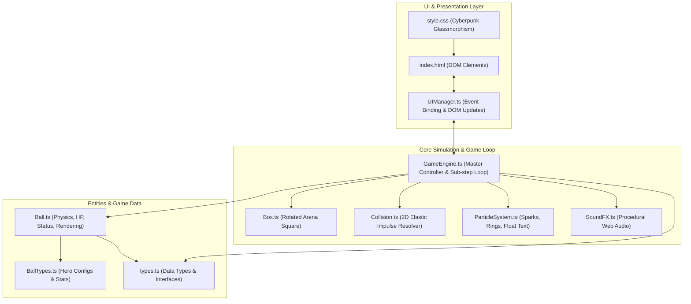
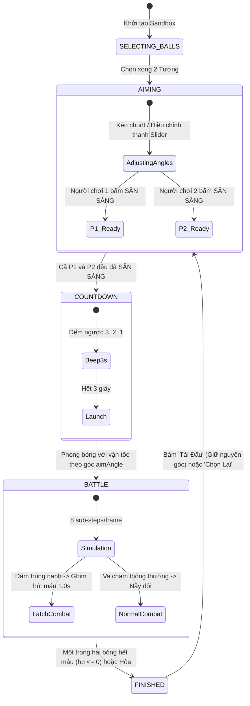
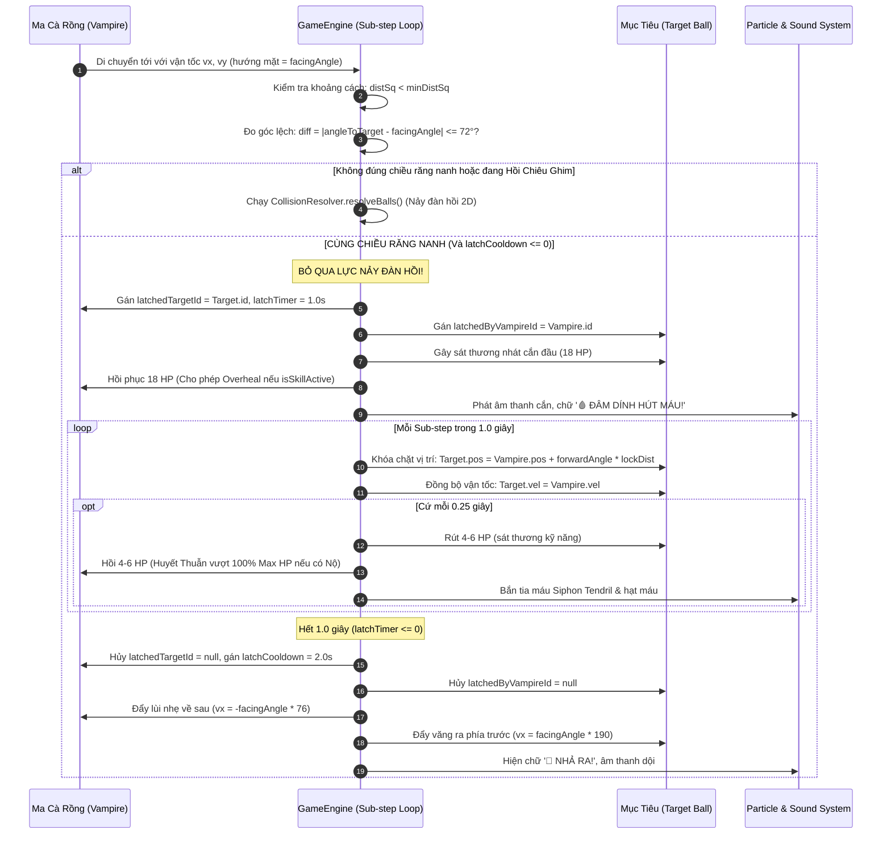

# RE-BOUND: Architectural Blueprint & System Specifications

Tài liệu kỹ thuật chuyên sâu mô tả kiến trúc phần mềm, biểu đồ luồng dữ liệu, máy trạng thái (State Machine) và chu kỳ vòng đời thực thi của dự án **Re-Bound**.

---

## 1. Kiến Trúc Phân Tầng (System Architecture)

---

## 2. Máy Trạng Thái Chế Độ Sandbox (Sandbox State Machine)

Chế độ Đấu Trường Thử Nghiệm (Sandbox Duel) hoạt động dựa trên máy trạng thái hữu hạn (FSM) gồm 5 pha:

---

## 3. Chi Tiết Chu Kỳ Ghim Đâm & Hút Máu (Vampire Latch & Overheal Lifecycle)

Biểu đồ trình tự thể hiện chính xác vòng đời từ lúc Ma Cà Rồng tiếp cận nạn nhân cho đến khi nhả ra:

---

## 4. Hệ Thống Các Tướng & Đặc Tính Chiến Thuật

| Mã Tướng | Tên Tướng | Icon | Máu Gốc | Sát Thương | Bán Kính | Kỹ Năng Kích Hoạt | Cơ Chế Nội Tại / Đặc Biệt |
| :--- | :--- | :---: | :---: | :---: | :---: | :--- | :--- |
| `BLAZE` | Hỏa Long | 🔥 | 120 | 10 | 20px | **Cú Lướt Bộc Phá (Meteor Dash):** Tăng x3.0 tốc độ trong 4.0s, tạo sóng xung kích cực lớn. | Sát thương va chạm tỷ lệ thuận theo vận tốc di chuyển. |
| `FROST` | Băng Ngân | ❄️ | 110 | 12 | 18px | **Vực Băng Vĩnh Cửu (Blizzard Domain):** Tạo vùng lãnh địa băng tồn tại 30s. | Kẻ địch trúng chiêu bị đóng băng cứng `FROZEN_SOLID` trong 3s (vận tốc = 0, **sát thương gây ra = 0**). |
| `TOXIC` | Độc Mãng | 🧪 | 95 | 14 | 17px | **Bão Độc Ăn Mòn (Acid Nova):** Phun 6 vũng độc tồn tại 4.5s. | Địch giẫm vũng độc bị rút 12 HP/s; rời vũng vẫn chịu độc ăn mòn lingering 3 HP/s. |
| `VOLT` | Lôi Thần | ⚡ | 100 | 11 | 18px | **Lôi Trận Quá Tải (Lightning Grid):** Cứ 1s tạo vệt sét di chuyển trong 0.5s, tồn tại 1.5s. | **+10% tốc độ mỗi lần chạm tường** (tối đa x2.2). Chạm vệt sét bị `ELECTRIFIED`: -30% sát thương đâm, +30% sát thương nhận vào. |
| `TITAN` | Cự Thần | 🛡️ | 180 | 15 | 25px | **Pháo Đài Bất Hoại (Unstoppable Fortress):** Giảm 60% sát thương nhận vào, tăng 40% kích thước & khối lượng. | Khối lượng lớn đẩy lùi tất cả các bóng khác khi va chạm. |
| `VAMPIRE` | Huyết Dạ | 🩸 | 105 | 10 | 18px | **Huyết Khát Cuồng Nộ (Blood Frenzy):** Tăng x2.0 tốc chạy trong 3s, nanh đỏ rực, đâm trúng gây Chảy Máu 3s. | **Ghim hút máu (Latch) 1.0s** khi đâm trúng mặt trước bằng nanh; có Nộ thì cho phép **Overheal lên tới 150% Max HP**. |

---

## 5. Quy Chuẩn Đồ Họa & Tọa Độ (Coordinate & Render Invariants)

1. **Hệ Tọa Độ Sàn Đấu (Box Space vs World Canvas Space):**
   - Tâm sàn đấu luôn nằm tại `(box.centerX, box.centerY)`.
   - Khi sàn đấu quay một góc $\theta$ (`box.angle`), tọa độ vật lý của bóng vẫn được lưu dưới dạng World Space `(ball.x, ball.y)`.
   - Khi tính toán va chạm thành tường, `Box.ts` chuyển đổi vị trí bóng sang hệ tọa độ cục bộ của hình vuông (Local Space) thông qua ma trận quay 2D, giải phóng va chạm và chuyển đổi ngược lại World Space.

2. **Kích Thước Khung Hình & Tỉ Lệ Co Giãn (Canvas Scaling):**
   - Canvas kích thước mặc định $900 \times 900$ với CSS `max-width: 100%`, `aspect-ratio: 1 / 1`.
   - Tỉ lệ hình vuông của sàn đấu luôn được bảo toàn độc lập với kích thước cửa sổ trình duyệt.

3. **Cấu Trúc Tầng Lớp Vẽ (Canvas Render Stack Order):**
   1. Xóa khung hình (`ctx.clearRect`).
   2. Vẽ sàn đấu hình vuông quay (`box.render`).
   3. Vẽ các vùng chướng ngại vật môi trường (Vực Băng `frostZones`, Vũng Độc `toxicPools`, Vệt Sét `lightningHazards`).
   4. Vẽ dây dẫn hút máu (`renderVampireLatchTether`).
   5. Vẽ các quả bóng (`ball.render` - bao gồm vệt trail, thân bóng, nanh nanh, hào quang, hiệu ứng đóng băng/nhiễm điện/chảy máu, thanh máu và thước nhắm).
   6. Vẽ hệ thống hiệu ứng hạt (`particleSystem.render` - sparks, shockwaves, floating text numbers).
